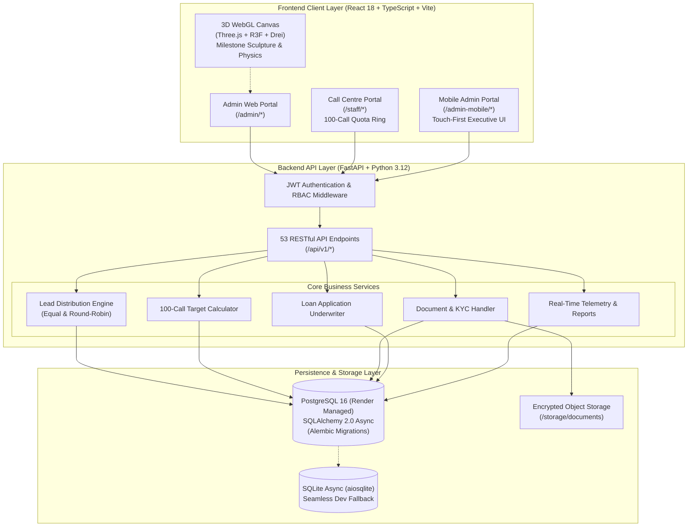
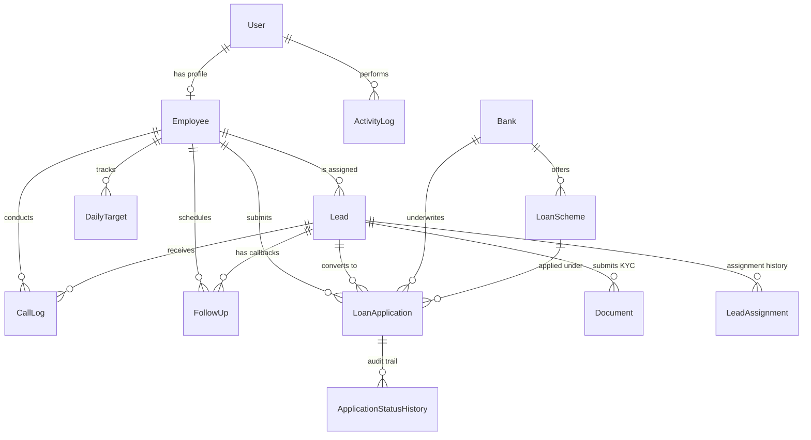

# LoanFlow – Enterprise Loan Sales & Call Centre CRM

> **A Production-Grade Financial Intermediary Platform & Next-Gen Lending CRM**  
> *Developed for CloudHouse Technologies Technical Assessment*

[](https://loanflow-crm-byanirudh.vercel.app)
[](https://loanflow-crm.onrender.com/api/v1/health)

[](https://fastapi.tiangolo.com/)
[](https://www.postgresql.org/)
[](https://reactjs.org/)
[](https://threejs.org/)
[](https://tailwindcss.com/)
[]()

---

## 🌐 Live Deployments

| Component | Platform | Live URL | Description |
| :--- | :--- | :--- | :--- |
| **Frontend Web App** | **Vercel** | [https://loanflow-crm-byanirudh.vercel.app](https://loanflow-crm-byanirudh.vercel.app) | Production SPA with interactive 3D studio, Admin, Staff, and Mobile portals |
| **Backend REST API** | **Render** | [https://loanflow-crm.onrender.com](https://loanflow-crm.onrender.com) | FastAPI on Python 3.12 with async PostgreSQL 16 & JWT RBAC |
| **Interactive API Docs** | **Swagger UI** | [https://loanflow-crm.onrender.com/docs](https://loanflow-crm.onrender.com/docs) | Complete OpenAPI / Swagger interactive documentation for 53 endpoints |

---

## 1. Executive Summary & Business Workflow

LoanFlow is an enterprise SaaS platform engineered for financial loan brokers operating between consumers and institutional partner banks. With approximately 20 call centre employees, the daily operational lifecycle follows a high-throughput, structured pipeline:

1. **Morning Lead Ingestion**: Admins upload batches of raw customer leads via CSV with duplicate phone number rejection and format validation.
2. **Algorithmic Distribution**: Leads are assigned evenly or via round-robin among active agents (e.g., 2,000 leads distributed to 20 agents yields exactly 100 leads per employee).
3. **100-Call Daily Quota Execution**: Each employee works toward a strict 100-call daily target, utilizing one-click call logging, contact attempts, and automated lead status progression.
4. **KYC & Document Underwriting**: Staff collect identity and income proofs (Aadhaar, PAN, salary slips, bank statements) and upload them for underwriting audit.
5. **Bank Submission & Loan Tracking**: Applications are submitted to partner banks (HDFC, ICICI, SBI, Axis, Kotak, Bank of Baroda, PNB, IDFC) under customized loan schemes, and tracked through underwriting, approval, and disbursement.

---

## 2. Next-Gen 3D Fintech Visual Experience & Design Tokens

LoanFlow features a unified, institutional **Light Alabaster / Mist Blue** design token system paired with interactive Three.js & React Three Fiber (`@react-three/fiber`, `@react-three/drei`) spatial computing visuals:

* **Hero Capital & Loan Milestone Sculpture**:
  * Scaled procedural 3D sculpture positioned behind the authentication card and in the executive cockpit.
  * Frosted glass & platinum core banking token with champagne gold inlay.
  * Three concentric milestone rings: Deep Navy (`#0F172A`), Warm Gold (`#B8860B`), and Slate (`#475569`).
  * Orbital milestone satellites including an emerald green approval node (`#059669`).
  * Real-time cursor tracking: rings tilt toward the pointer and accelerate dynamically; triggers high-speed orbital spin upon successful authentication.
* **Floating Glass Financial Elements**:
  * 9 floating frosted-glass coins, credit cards, and rounded cubes with realistic light transmission (`meshPhysicalMaterial`).
  * Natural sinusoidal bobbing and spring-physics cursor repulsion (items drift away when the cursor approaches, then smoothly ease back).
* **Click Ripple & Coin Particle Bursts**:
  * Canvas-level interaction: clicking the background emits expanding blue ripple waves and a burst of gold coin particles.
* **Refined Institutional Design Tokens**:
  * **Page Background**: `#F1F3F7` to `#E8ECF4` soft mist gradient.
  * **Glass Surfaces**: Frosted white (`rgba(255, 255, 255, 0.85)`) with `backdrop-blur-xl`, `1px rgba(15, 23, 42, 0.08)` borders, and deep elevation shadows.
  * **Primary Ink & Accents**: Deep Navy (`#0F172A`) and Royal Blue (`#2563EB`).
  * **Interactive Micro-Effects**: 3D card perspective tilt (max 3.5°) with specular sheen (auto-pauses while typing for input stability), magnetic action button (pulls up to 8px toward cursor), and horizontal shake on authentication errors.
  * **Accessibility**: Automatic fallback to `StaticGradientMesh` for `prefers-reduced-motion` or low-power devices.

---

## 3. System Architecture



---

## 4. The Three Dedicated Portals

LoanFlow provides three distinct, first-class interfaces tailored to user roles and physical contexts:

### A. Admin Web Portal (`/admin/*`)
Designed for desktop operations management, providing 11 full modules:
1. **Executive Dashboard**: Database-driven metrics (zero hardcoded values), 6 Recharts visualizations (Daily Calling Area Chart, Weekly Lead Intake Bar Chart, Shift Leaderboard, Lead Status Donut, Application Pipeline Bar Chart, Conversion Funnel).
2. **Lead Management**: Full CRUD, search, status/priority filters, pagination, bulk CSV import with duplicate phone rejection, CSV export, and complete lead profile drawers.
3. **Employee Management**: Agent directory, activation/deactivation toggle, password resets, daily target adjustments, and individual performance scorecards.
4. **Lead Distribution Engine**: Bulk assignment with exact mathematical split or round-robin rotation, handling uneven remainders cleanly.
5. **Call Management**: Real-time supervisory call activity stream with duration formatting, agent filters, and outcome breakdown.
6. **Follow-Up Management**: Centralized queue with Due Today, Overdue, Upcoming, and Completed tabs, supporting 1-click completion and rescheduling.
7. **Document Management**: KYC verification queue with file preview, download, and instant verify/reject with rejection notes.
8. **Partner Bank Management**: Management of lending institutions (HDFC, ICICI, SBI, Axis, Kotak, Bank of Baroda, PNB, IDFC) and active statuses.
9. **Loan Scheme Catalog**: Catalog of bank schemes with interest rates, min/max amounts, tenure constraints, and eligibility criteria.
10. **Loan Application Management**: Underwriting pipeline tracking with audit trails and stage progression (Draft → Submitted → Approved → Disbursed).
11. **Reports & BI**: Multi-dimensional reports (Calls, Employees, Banks, Lead Sources) with one-click CSV data exports.

### B. Staff / Call Centre Portal (`/staff/*`)
Optimized for call centre agents focused on achieving their daily 100-call quota:
- **Circular 100-Call Target Progress**: Live visual progress ring, remaining calls counter, and percentage achieved.
- **My Assigned Leads**: Lead list filtered strictly to the logged-in agent, with inline call logging and KYC upload drawers.
- **Quick Call Logger**: Modal for logging call outcomes (Interested, Follow-up Required, Busy, No Answer) with automatic lead status update and follow-up scheduling.
- **My Follow-ups**: Prioritized callbacks with overdue visual warnings.
- **Document Uploader**: Customer document ingestion supporting PDF, JPG, and PNG files up to 10MB.
- **Loan File Tracker**: Submit applications to banks and view stage progress.
- **Personal Performance Scorecard**: 14-day call trends against the 100-call threshold and team leaderboard ranking.

### C. Dedicated Mobile Admin Portal (`/admin-mobile/*`)
**Not a desktop responsive collapse or static dashboard preview**, but an independent mobile-first administrative application:
- Custom mobile app shell with quick bottom navigation and drawer menu.
- Touch-friendly cards, swipeable tabs, and mobile modals for all 11 administrative modules.
- On-the-go lead assignment, agent password resets, document verification, and stage approvals.
- Instant access to executive CSV exports and phone call supervisions.

---

## 5. Default Demo Credentials

The database comes pre-seeded with test data (admin, 5 call centre staff, 25 leads, banks, schemes, call logs, and documents).

| Portal | Role | Email | Password | Daily Target | Quick Autofill |
| :--- | :--- | :--- | :--- | :--- | :--- |
| **Admin Web Portal** | Admin | `admin@loanflow.demo` | `Password123!` | Executive Suite | Click `[Admin]` Tab |
| **Mobile Admin Portal** | Admin (Mobile) | `admin@loanflow.demo` | `Password123!` | Mobile Cockpit | Click `[Mobile Admin]` Tab |
| **Call Centre Agent 1** | Staff | `staff1@loanflow.demo` | `Password123!` | 100 Calls / Day | Click `[Agent]` Tab |
| **KYC Underwriter** | Staff (KYC) | `staff2@loanflow.demo` | `Password123!` | 100 Calls / Day | Click `[KYC Agent]` Tab |
| **Staff Agent 3** | Staff | `staff3@loanflow.demo` | `Password123!` | 100 Calls / Day | Manual login |
| **Staff Agent 4** | Staff | `staff4@loanflow.demo` | `Password123!` | 100 Calls / Day | Manual login |
| **Staff Agent 5** | Staff | `staff5@loanflow.demo` | `Password123!` | 100 Calls / Day | Manual login |

*Tip: The redesigned login page features a 1-click segmented persona selector that automatically populates credentials for instant evaluation.*

---

## 6. Technology Stack & Key Libraries

### Frontend
- **Framework**: React 18+ with TypeScript
- **Bundler**: Vite
- **3D & Spatial Computing**: Three.js, `@react-three/fiber`, `@react-three/drei`
- **Styling**: Tailwind CSS with custom Mist Blue / Alabaster FinTech tokens
- **State Management**: TanStack Query (React Query v5) with automatic cache invalidation
- **HTTP Client**: Axios with interceptors for JWT Bearer injection and 401 handling
- **Visualizations**: Recharts (Area, Bar, Pie/Donut, Funnel charts)
- **Icons**: Lucide React
- **Notifications**: Sonner

### Backend
- **Framework**: FastAPI (Python 3.12+)
- **Server**: Uvicorn with async event loop
- **ORM**: SQLAlchemy 2.0 (AsyncSession)
- **Database**: PostgreSQL 16 (production on Render) with SQLite/aiosqlite seamless local fallback
- **Validation**: Pydantic v2 & Pydantic-Settings
- **Security**: Native `bcrypt` password hashing and JWT token handling (`python-jose`)
- **Data & Files**: Pandas & openpyxl for CSV/Excel ingestion, python-multipart for uploads

---

## 7. Quickstart & Local Installation

### Prerequisites
- Python 3.12+
- Node.js 18+ and npm
- (Optional) Docker and Docker Compose

### Option A: Local Run (Quickest)

#### 1. Backend Setup
```bash
cd backend

# Create and activate virtual environment
python -m venv venv
# On Windows:
.\venv\Scripts\activate
# On Linux/macOS:
source venv/bin/activate

# Install dependencies
pip install -r requirements.txt

# Seed the database with demo users, leads, banks, and calls
python -m app.db.seed

# Start FastAPI development server
uvicorn app.main:app --host 0.0.0.0 --port 8000 --reload
```
The interactive Swagger API documentation will be available at [http://localhost:8000/docs](http://localhost:8000/docs).

#### 2. Frontend Setup
In a new terminal window:
```bash
cd frontend

# Install packages
npm install

# Start Vite dev server
npm run dev
```
Open [http://localhost:5173](http://localhost:5173) in your browser.

---

### Option B: Docker Compose (Full Stack with PostgreSQL)

To launch the complete containerized stack (PostgreSQL + FastAPI + Nginx SPA):
```bash
# In the project root directory:
docker-compose up --build
```
- Frontend application: [http://localhost:3000](http://localhost:3000) or [http://localhost](http://localhost)
- Backend API: [http://localhost:8000](http://localhost:8000)
- Swagger Docs: [http://localhost:8000/docs](http://localhost:8000/docs)

---

## 8. Running Automated Tests

The backend test suite verifies authentication, RBAC permission enforcement, lead creation, and 100-call quota calculations:

```bash
cd backend
pytest -v
```

All 11 integration tests will execute and pass:
```
tests/test_api.py::test_health_check PASSED
tests/test_api.py::test_login_success PASSED
tests/test_api.py::test_login_invalid_password PASSED
tests/test_api.py::test_admin_dashboard_stats PASSED
tests/test_api.py::test_create_lead PASSED
tests/test_api.py::test_list_leads_filter PASSED
tests/test_api.py::test_daily_call_progress PASSED
tests/test_api.py::test_create_call_log_updates_progress PASSED
tests/test_api.py::test_staff_cannot_access_admin_dashboard PASSED
tests/test_api.py::test_bulk_assign_leads PASSED
tests/test_api.py::test_list_banks PASSED
```

To verify the frontend TypeScript and build output:
```bash
cd frontend
npm run build
```

---

## 9. Database Schema & Entity Relationships



---

## 10. API Endpoints Reference

The backend exposes 53 REST endpoints under `/api/v1`:

- **Authentication**: `POST /auth/login`, `POST /auth/logout`, `GET /auth/me`
- **Users & Profile**: `GET /users`, `GET /users/{id}`, `PUT /users/{id}`, `PATCH /users/{id}/toggle-status`
- **Employees**: `GET /employees`, `POST /employees`, `GET /employees/{id}`, `PUT /employees/{id}`, `POST /employees/{id}/reset-password`, `GET /employees/performance`
- **Leads**: `GET /leads`, `POST /leads`, `GET /leads/{id}`, `GET /leads/{id}/details`, `PUT /leads/{id}`, `DELETE /leads/{id}`, `GET /leads/template`, `POST /leads/import`, `GET /leads/export`, `POST /leads/bulk-assign`
- **Calls & Quotas**: `GET /calls`, `POST /calls`, `GET /calls/{id}`, `GET /calls/progress`
- **Follow-ups**: `GET /followups`, `POST /followups`, `PATCH /followups/{id}/complete`, `PATCH /followups/{id}/reschedule`
- **Documents & KYC**: `GET /documents`, `POST /documents/upload`, `GET /documents/{id}/download`, `POST /documents/{id}/verify`
- **Banks**: `GET /banks`, `POST /banks`, `GET /banks/{id}`, `PUT /banks/{id}`
- **Loan Schemes**: `GET /loan-schemes`, `POST /loan-schemes`, `GET /loan-schemes/{id}`, `PUT /loan-schemes/{id}`
- **Loan Applications**: `GET /applications`, `POST /applications`, `GET /applications/{id}`, `PATCH /applications/{id}/status`, `GET /applications/{id}/history`
- **Analytics**: `GET /analytics/dashboard`, `GET /analytics/staff-dashboard`, `GET /analytics/daily-calls`, `GET /analytics/weekly-leads`, `GET /analytics/leaderboard`, `GET /analytics/lead-distribution`, `GET /analytics/loan-pipeline`, `GET /analytics/conversion-funnel`
- **Reports**: `GET /reports/call-performance`, `GET /reports/employee-performance`, `GET /reports/bank-wise`, `GET /reports/lead-source`, `GET /reports/export`

---

## 11. Deployment Architecture

### Vercel (Frontend SPA)
* **Production URL**: [https://loanflow-crm-byanirudh.vercel.app](https://loanflow-crm-byanirudh.vercel.app)
* Built using Vite with dynamic code splitting and client-side routing rewrites (`vercel.json`).
* Configured with `VITE_API_URL=https://loanflow-crm.onrender.com/api/v1`.

### Render (Backend & Managed PostgreSQL)
* **Web Service**: [https://loanflow-crm.onrender.com](https://loanflow-crm.onrender.com)
* Managed PostgreSQL 16 database instance connected via asyncpg connection pooling.
* Declarative deployment managed via `render.yaml` with automatic seed script initialization and schema migrations.

---

**Built with precision, high-throughput capability, and enterprise polish for the CloudHouse Technologies technical assessment.**
